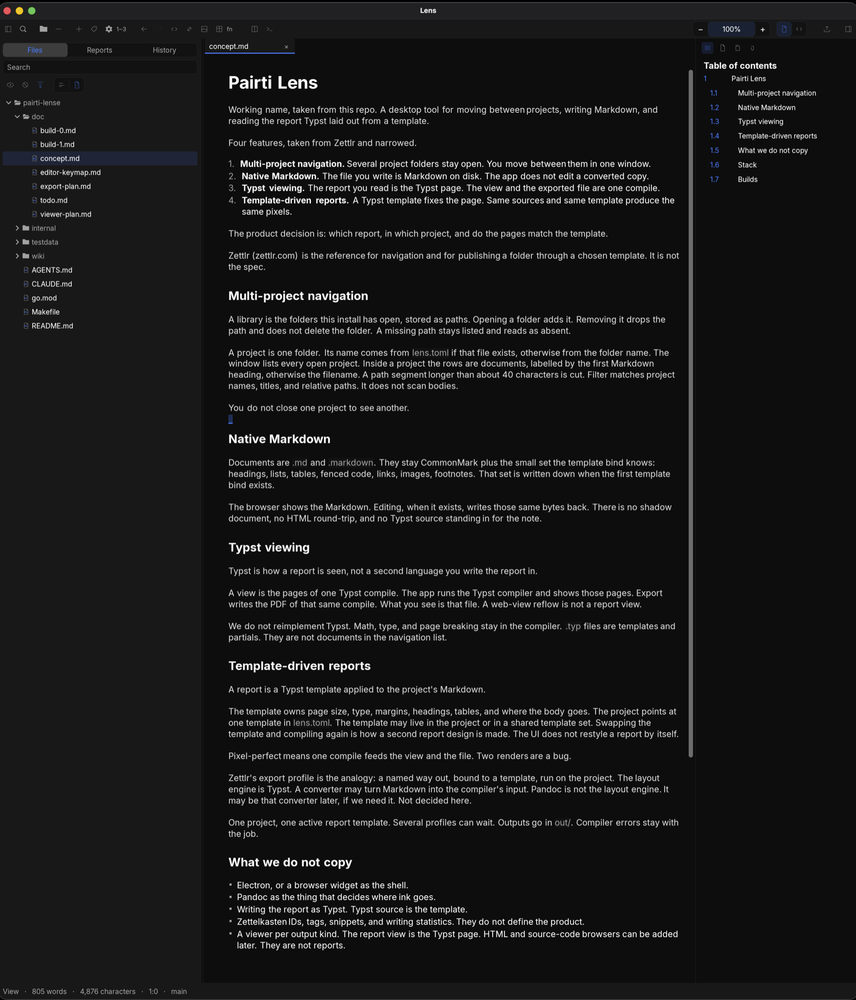
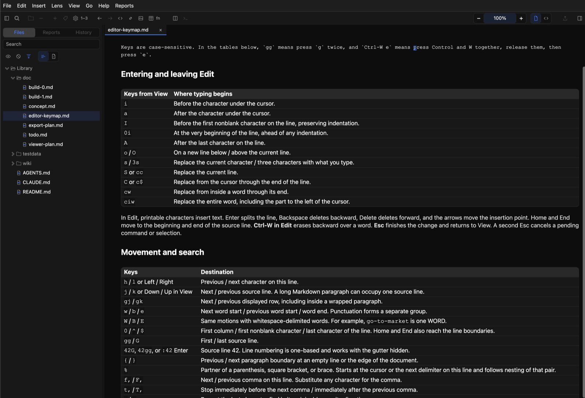

# Pairti Lens

## Motivation

Oh no, not another Markdown viewer and editor. I keep the work as projects in Git, with several folders open at once, and I want a compiled Typst report whose preview is the PDF I export. After years with Electron editors I wanted a fast app in Go, drawn on the GPU in a native OS window. Lens takes its lead from Zettlr.

A desktop Markdown editor for notes and reports kept in Git repositories.



## Why Lens

Lens keeps several project folders open in one library. Reports compile through a Typst template, and the preview shows the same PDF that export writes. The app is a small Go program that opens a native OS window and draws it on the GPU with GoGPU. It does not use Electron or a web view.

A local MCP connection lets an assistant on the same machine read and edit the focused note.

## Features

- Project library. Several folders stay open in one window
- The file tree lists one folder at a time and leaves generated trees such as `node_modules` and `.git` closed. Gitignored names are hidden by default, and a large folder is capped.
- Markdown editing with an outline
- Git history for a document or its project
- Typst PDF export, with a preview of the exported pages
- Pandoc export to `.docx`
- A lexical search index over open projects
- File watching with reloads after writes settle
- MCP on loopback (`127.0.0.1:47328`) with a bearer token
- MCP tools `document` and `apply_edit`, bound to the focused note

See the [editor keymap](doc/editor-keymap.md) for keyboard shortcuts.

## Requirements

macOS is the documented platform. A build needs Go 1.27.4 or later and Make.

Install the command-line tools for the outputs you use and make them available on your `PATH`.

| Tool | Used for |
| --- | --- |
| Typst | Compile PDF reports |
| Poppler (`pdftoppm`) | Render PDF pages for preview |
| Pandoc | Export Word documents |

## Build and run on macOS

From the repository root, with Go 1.27.4 or later and Make installed:

```sh
make binary
./build/pairti-lense
```

To run directly from source, use `CGO_ENABLED=0 go run ./cmd/pairti-lense`.

Add a project folder to the library, then select a Markdown file to start reading or editing.

To install the application bundle in `~/Applications/Lens.app`, run `make app`. You can then launch **Lens** from Spotlight.

## Serve Lens in a browser

From the repository root, with Go 1.27.4, Make and Git installed, run:

```sh
make wasm-serve
```

Open `http://localhost:8081/library/` in a WebGPU-capable browser. By default Lens serves tracked Markdown in the current checkout. To serve another checkout, run `make wasm-serve LIBRARY=/srv/writing`. Ctrl-C stops the server. For a build only, run `make wasm`; the browser assets are in `build/wasm/`.



For local import/download, open `http://localhost:8081/local/` and use **File → Import Markdown…**. Edits live in the tab until you download them. This uses the same editor and layout.

On a remote host, forward its loopback port over SSH and open the same URL locally:

```sh
ssh -N -L 127.0.0.1:8081:127.0.0.1:8081 writer@library-host
```

Expand **Library** in the Files sidebar and click a tracked Markdown file. Use the toolbar or **View** menu to switch between Formatted and Raw, split panes or show the outline. Edit the note and choose **File → Save** or use `:w`. A successful save replaces the file in the server checkout. Review the change with `git diff`; commit, pull and push using the repository's normal workflow. Reload the page to refresh the document list.

If two writers open the same revision, the first save succeeds. The second writer sees a conflict and keeps their edits. **File → Download Markdown** keeps a local copy of the draft. Close the tab with **File → Close Tab**, confirm the discard, then reopen the file from the sidebar to load the server revision. Changes already on disk from an external editor or Git operation also invalidate the old revision. Coordinate Git operations with saves: external processes do not share the server's write lock.

Run one Lens server per checkout. It listens on loopback; use SSH accounts with forwarding access for trusted writers. Anyone with access to this port can read and edit the whole exposed library. The server exposes tracked regular UTF-8 Markdown files up to 1 MiB. Untracked documents, symlinks and unresolved index conflicts are excluded. Desktop and WASM both build `./cmd/pairti-lense`. They share the Go shell, project tree, search, tabs, document toolbar, Raw and Formatted editors, split panes, outline, footer and menu command definitions. The browser launcher renders the menu bar and supplies HTTP or import/download storage. Git history, report publishing, the terminal, system file actions, relative image assets and per-document permissions still need browser or server support.

## Status

Lens is early. The current version is 0.1.0. WASM support is in progress.

## Licence

Lens is released under the MIT Licence. See [LICENSE](LICENSE).

## Report brand packs

A clean installation offers **Default (pdf)** and **Default (docx)**. Install a pack by copying its directory under the Lens user configuration. On macOS, try the fictional Cedar Studio example from the repository root:

```sh
mkdir -p "$HOME/Library/Application Support/pairti-lense/brands"
cp -Rf testdata/brands/cedar "$HOME/Library/Application Support/pairti-lense/brands/"
```

On Linux the parent is `$XDG_CONFIG_HOME/pairti-lense/brands` (normally `~/.config/pairti-lense/brands`). On Windows it is `%AppData%\pairti-lense\brands`. Reopen the export sheet to see both formats.

The folder name is the saved template ID. Use lowercase letters, digits, hyphens or underscores; `default` is reserved. Keep this name when updating the pack. In `brand.json`, set `version` to 1, a display `label`, a PNG `logo` and a Word `reference` document. Asset paths are relative to the pack. The Word reference supplies its running header and styles; set the matching PDF header in `header`. The manifest supplies the disclosure and licence for both formats. Optional `stylePrefix` selects Word style names, `logoWidth` is in millimetres, and `fonts/` holds optional Typst fonts with their redistribution notices. See the [example manifest](testdata/brands/cedar/brand.json).
